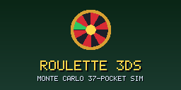
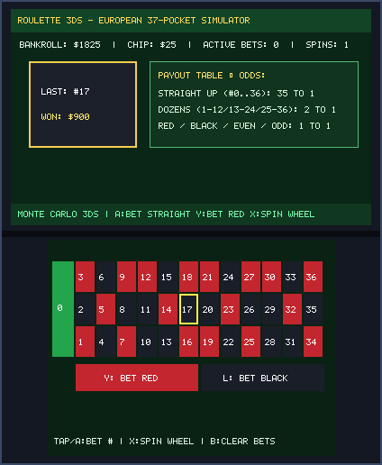
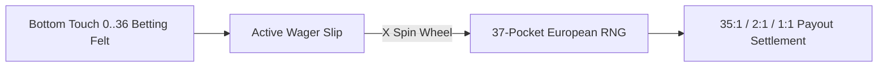

# Roulette 3DS (`3ds_roulette`)

<p align="center">
  
  &nbsp;&nbsp;&nbsp;
  
</p>

<p align="center">
  
</p>

> **Monte Carlo 37-Pocket Sim (`CTR-P-ROUL`, UniqueId `0x0D3EE`)** — Part of the [**lafiabrew**](https://github.com/orgs/lafiabrew/repositories) Nintendo 3DS Homebrew Suite.

European 37-pocket (`0..36`) Roulette wheel & felt betting simulator supporting Straight-Up (`35:1`), Dozens (`2:1`), and Red/Black/Even/Odd (`1:1`).

---

## Architecture & Data Flow



---

## Controls & Touch Ergonomics

| Button / Input | Action |
|---|---|
| `D-Pad` / `Touch Felt` | Select pocket `#0..36` on the European felt table |
| `A` | Place Straight-Up chip wager (`35:1` payout) |
| `Y` / `L` | `Y`: Bet on Red (`1:1`) | `L`: Bet on Black (`1:1`) |
| `X` / `B` | `X`: Spin Wheel & settle payouts | `B`: Clear bets and refund stake |

---

## Build, Verify & Install

```bash
make test
make 3ds && make verify-3ds
make qr
```
